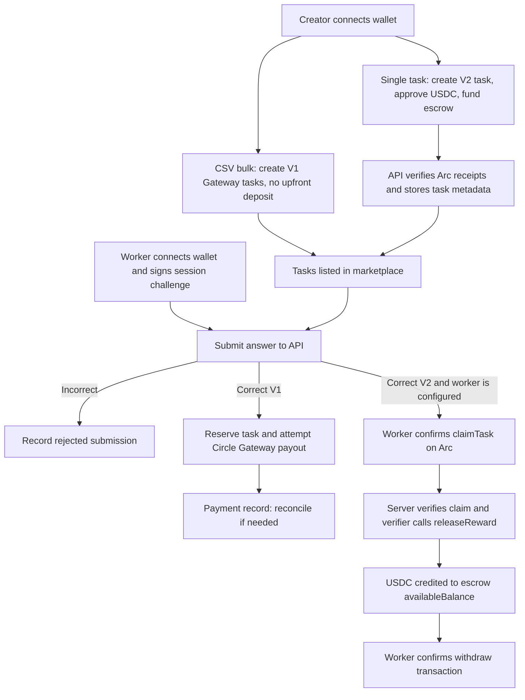
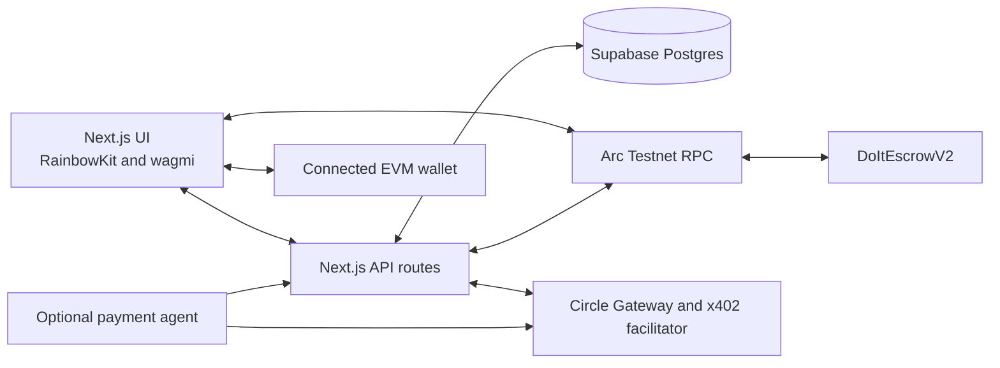

# Do-It

### A task marketplace for useful work and USDC micropayments

Do-It is an application prototype for publishing small digital tasks, collecting worker submissions, and coordinating rewards through Circle Gateway or an Arc Testnet escrow contract. It brings task details, wallet identity, payment records, and transaction verification into one workflow.

> **Project status:** active prototype. The application currently targets Arc Testnet. V2 worker submissions are restricted by an application-configured test-worker list; the restriction is not enforced by the escrow contract itself. Do not use this repository as a production marketplace without a separate security and operational review.

## Overview

Small online tasks can be awkward to coordinate: creators need a way to describe and verify work, while contributors need clear reward terms and a workable way to get paid. Manual review and conventional payment rails can add friction, especially for low-value work.

Do-It explores a task economy where creators publish work, contributors submit answers, and accepted work can trigger USDC settlement. Circle Gateway supports the project's testnet payment flows; Arc provides the EVM network used by the current payment and V2 escrow implementation. Circle Gateway and Arc are integrations used by Do-It, not protocols created by this project.

The app is intended for task creators, workers, and developers exploring small-value payment flows. Example app uses include simple research, content checks, data labeling, and paid API demonstrations.

## How It Works

### Task marketplace

1. **Create a task.** The single-task form creates a V2 task on Arc Testnet. The creator connects a wallet, creates the escrow task, approves USDC, funds the task, and then submits the transaction details so the server can verify and save marketplace metadata.
2. **Create tasks in bulk.** CSV bulk creation creates V1 Gateway tasks. It does not deposit or reserve USDC at task creation. A Gateway-funded seller wallet is needed later if a V1 payout is attempted.
3. **Authorize a worker wallet.** A worker signs a short-lived wallet-session challenge. The server sets a session cookie and derives the worker identity from that signed session when handling submissions.
4. **Submit an answer.** The API compares the answer with the stored expected answer. Incorrect answers are recorded without payment. Correct-answer flows reserve the task and create submission/payment records.
5. **Complete V1 rewards through Gateway.** For V1 tasks, the server attempts the existing Circle Gateway payout flow. A transaction may need reconciliation if it was broadcast but the app could not finish updating its payment record.
6. **Claim and earn on V2.** For V2 tasks, an eligible worker confirms the `claimTask` transaction. The server verifies the claim and uses the configured verifier signer to call `releaseReward`. This credits the worker's `availableBalance` in the escrow contract; it does not transfer USDC to the worker's wallet at that point.
7. **Withdraw V2 earnings.** The worker submits a separate `withdraw` transaction from their wallet. The UI shows a $1.00 eligibility indicator based on the connected wallet's balance, but the contract does not enforce a $1 minimum.

The app automates answer comparison, database reservations, configured Gateway calls, and server-side transaction verification. Wallet connection, signed wallet authorization, task funding, the V2 claim, and V2 withdrawal require wallet actions. V2 reward credit requires the server verifier signer.



## Features

- **Single V2 task creation:** creates, funds, and records a task using the Arc Testnet escrow contract.
- **CSV task creation:** parses and validates batches of up to 250 V1 Gateway tasks, with a 2 MB upload limit, batch idempotency, row feedback, and downloadable invalid-row reports.
- **Task discovery and submission:** browse open tasks, view task details, and submit answers using a wallet-bound server session.
- **Creator task management:** inspect creator tasks and delete eligible unused tasks or archive records that have submissions, payments, or V2 escrow history; archival requires the applicable server-side and chain-state checks.
- **Separate V1 and V2 reward paths:** V1 uses the existing Circle Gateway payout path; V2 credits escrow earnings and supports direct worker withdrawal.
- **Payment retry and reconciliation:** API routes inspect payment records and transaction receipts to handle incomplete or failed payment updates.
- **Worker V2 earnings history:** reads the V2 contract balance and displays confirmed `EarningsWithdrawn` history recorded from verified Arc events.
- **Paid API examples:** several `/api/premium/*` routes demonstrate x402 payment verification and settlement through Circle's batching facilitator.
- **Payment agent:** an optional script exercises the paid API routes using an ephemeral wallet funded from a configured testnet wallet.

## Architecture



- **Next.js frontend and API:** pages and React components collect task data, connect wallets, submit answers, and call server routes. Server routes validate wallet sessions and use Supabase and Arc RPC clients.
- **Wallet integration:** RainbowKit and wagmi connect browser wallets and submit the explicit Arc transactions required for task creation, V2 claiming, and withdrawal. A signed worker session is used for API identity; the session cookie is server-validated.
- **Supabase:** stores task metadata, submissions, payment status, batch idempotency records, wallet challenges, and withdrawal history. Server API routes use the service-role key for privileged operations. Keep that key server-side.
- **Circle Gateway:** used by the V1 Gateway payout flow and the separate x402-protected API examples. The app's V1 payout code requests a Circle transfer attestation, then submits a Gateway mint transaction on Arc.
- **Arc Testnet:** provides the current EVM network, test USDC, RPC reads, and transactions for the V2 escrow and Gateway settlement paths.
- **DoItEscrowV2:** holds creator-funded task rewards. The verifier credits accepted rewards to workers' on-contract balances; workers withdraw those balances in a separate transaction.

## Technology Stack

| Area | Technologies |
| --- | --- |
| Frontend | Next.js 16, React 19, TypeScript, Tailwind CSS 4, Radix UI |
| Wallet and EVM | RainbowKit, wagmi, viem, Solidity 0.8.26 |
| Payments | Circle `@circle-fin/x402-batching`, x402 core/EVM packages, Arc Testnet USDC |
| Backend and data | Next.js Route Handlers, Supabase JS/SSR, PostgreSQL migrations |
| Agent | Node.js TypeScript entrypoint, LangChain, Deep Agents, OpenAI integration (optional) |
| Contract development | Foundry (`forge`, `cast`, `anvil`), OpenZeppelin Contracts |
| Quality tools | ESLint, TypeScript, Node's test runner, Foundry tests |

The project uses npm lockfiles. The root package has scripts for `dev`, `build`, `start`, and `lint`; it does not define an `npm test` script.

## Network and Payments

The current application configuration targets **Arc Testnet**, chain ID **5042002**. The configured Arc Testnet USDC address is `0x3600000000000000000000000000000000000000`. The V2 escrow address in the app ABI is `0x024539183A57428C63B2F2628b881105213332E4`; the verifier address configured by the deployment script is `0x41aa5227695B8c6c5FfAD3bF3A9aAF0626921d0E`.

These addresses and flows are testnet configuration. Testnet assets are not a promise of real-world value. This README does not describe a mainnet deployment.

### V1 Gateway tasks

CSV-created V1 tasks do not escrow funds at creation. When a correct answer is accepted, the app attempts to pay the worker using the seller's Circle Gateway balance. The server signs the Gateway transfer intent and broadcasts a Gateway mint transaction on Arc. The seller wallet needs sufficient Gateway balance and the configured RPC must be reachable. A submitted transaction may remain pending or need reconciliation.

The seller dashboard also includes a separate Gateway balance and withdrawal interface. It is distinct from worker V2 escrow earnings.

### V2 escrow tasks

Single-task creation uses the V2 contract. Funding transfers USDC into the escrow contract. On accepted work, the configured verifier calls `releaseReward`, which changes task state and credits the worker's `availableBalance` in contract accounting. The worker later calls `withdraw` to transfer USDC to their wallet.

The V2 app checks `DOIT_V2_TEST_WORKERS` before allowing a worker through its submission flow. This is an application restriction: the contract's `claimTask` function itself does not restrict claims to that list. Do not treat the app allowlist as an on-chain access control. The displayed $1.00 withdrawal eligibility threshold is informational and is not enforced by the contract.

### x402 API examples

The `/api/premium/quote`, `/dataset`, `/compute`, and `/agent-task` routes use a Circle Gateway facilitator to verify and settle payment-signature requests. Their current example prices are $0.001, $0.01, $0.0003, and $0.03 USDC respectively. These paid demo endpoints are separate from worker rewards in the task marketplace.

## Prerequisites

- Node.js 22 or newer and npm.
- Docker and the Supabase CLI for the local database path.
- An Arc Testnet-compatible EVM wallet for browser flows.
- A WalletConnect project ID for the RainbowKit configuration.
- Supabase local services or a Supabase project configured for development.
- Arc Testnet RPC access. V2 server reads default to the public Arc Testnet RPC; V1 payout code reads `ARC_RPC_URL`.
- For V1 Gateway payouts, a configured seller wallet and testnet Gateway funds.
- For V2 reward credits, the private key for the configured verifier address and a test-worker address in the app allowlist.
- For the optional agent, a funded testnet buyer wallet. An OpenAI API key is optional; the script documents a mock/scripted fallback.

## Getting Started

1. Clone the repository and install the root dependencies:

   ```bash
   git clone https://github.com/Sharon-dev-create/do_it.git
   cd do_it
   npm install
   ```

2. Install or configure Docker and the Supabase CLI according to your environment's approved setup. Start the **local** Supabase stack from the repository:

   ```bash
   npx supabase start
   npx supabase status
   ```

   Confirm the displayed services are local before using them. The project config specifies Postgres 17 and local ports 54321–54324. To rebuild a disposable local database from the checked-in migration history, run:

   ```bash
   npx supabase db reset --local
   ```

   This reset is destructive to the local database. Do not remove `--local` or use this command against a linked/production project. The checked-in Supabase config names `supabase/seed.sql`, but that file is not present; setup currently depends on migrations and any manual local configuration required by your Supabase CLI version.

3. Copy the example environment file and fill in local/testnet settings:

   ```bash
   cp .env.example .env.local
   ```

   Set the Supabase URL and publishable key from the verified local Supabase status output. Add a WalletConnect project ID and the Arc RPC variables needed for the flows you intend to exercise. Keep `.env.local` out of version control. Do not use production credentials for local testing.

4. Set up wallet values only in a secure local secret store or ignored `.env.local`. Do not paste private keys into source files or commit them. For V2 reward credit, the configured verifier key must derive to the verifier address listed above. For V1 Gateway payout, configure the intended seller wallet and ensure it has testnet Gateway balance.

5. Start the web application:

   ```bash
   npm run dev
   ```

   Open `http://localhost:3000` (or the port configured by your environment).

6. To run the payment agent, configure its buyer wallet and start the application first, then run:

   ```bash
   npm run agent
   ```

   The agent sends testnet transactions to fund an ephemeral wallet, so run it only when you intend to use test assets. `BASE_URL` and `DEPOSIT_AMOUNT` can adjust its target and Gateway deposit amount.

## Environment Variables

The table reflects variables referenced in source. `.env.example` is not exhaustive: it currently omits `NEXT_PUBLIC_WALLETCONNECT_PROJECT_ID` and `ARC_RPC_URL`. Variables used only by Vercel or the runtime platform are not listed.

| Variable | Required? | Exposure | Purpose |
| --- | --- | --- | --- |
| `NEXT_PUBLIC_SUPABASE_URL` | Yes | Client-visible | Supabase project URL used by browser, server, and API clients. |
| `NEXT_PUBLIC_SUPABASE_PUBLISHABLE_KEY` | Yes | Client-visible | Supabase publishable/anon key used by browser and SSR clients. |
| `SUPABASE_SERVICE_ROLE_KEY` | Yes, server operations | **Server-only secret** | Privileged database access and HMAC secret for worker session cookies. Never expose it to browser code. |
| `NEXT_PUBLIC_WALLETCONNECT_PROJECT_ID` | Yes for wallet UI | Client-visible | RainbowKit project configuration. |
| `SELLER_ADDRESS` | Yes for Gateway seller features | Public address | x402 payment destination and seller Gateway balance identity. |
| `SELLER_PRIVATE_KEY` | Yes for V1 payouts/Gateway withdrawals | **Server-only secret** | Signs server-side Gateway operations. It is also a fallback V2 signer only if it derives to the configured verifier address. |
| `ARC_RPC_URL` | Required for V1 task payout | Server configuration | Arc RPC used to retrieve nonce and send Gateway mint transactions. No code fallback is set in that payout path. |
| `ARC_TESTNET_RPC_URL` | Optional | Server configuration | V2 server RPC override; defaults to `https://rpc.testnet.arc.network`. |
| `DOIT_VERIFIER_PRIVATE_KEY` | Required for V2 reward credit unless seller key matches verifier | **Server-only secret** | Dedicated signer for the V2 verifier. The derived address is checked against the configured verifier address. |
| `DOIT_V2_TEST_WORKERS` | Required for V2 worker submissions | Server configuration | Comma-separated wallet allowlist for the app's V2 submission route. It does not restrict direct contract calls. |
| `BUYER_PRIVATE_KEY` | Optional; required for agent | **Server/CLI secret** | Funds the agent's ephemeral wallet and deposits into Gateway. Never use a valuable wallet for this demo. |
| `OPENAI_API_KEY` | Optional | Server/CLI secret | Enables the agent's model-backed behavior; the script has a mock/scripted fallback when omitted. |
| `BASE_URL` | Optional; agent only | Local configuration | Agent API base URL; defaults to `http://localhost:3000`. |
| `DEPOSIT_AMOUNT` | Optional; agent only | Local configuration | USDC amount the agent deposits; defaults to `1`. |
| `PORT` | Optional | Local configuration | Port used by the development server/runtime when supported. |

`BUYER_ADDRESS` appears in `.env.example`, but the current agent derives its wallet address from `BUYER_PRIVATE_KEY` and does not read `BUYER_ADDRESS`. Use testnet-only wallets and credentials for the prototype. Never put private keys, service-role keys, or OpenAI keys in `NEXT_PUBLIC_*` variables or client components.

## Usage Guide

### Create a single V2 task

1. Open **Create task** and connect an Arc Testnet wallet.
2. Enter a title, description, expected answer, and USDC reward.
3. Confirm the contract interactions in your wallet: create the task, approve USDC, and fund the escrow.
4. The app verifies the create/fund receipts and saves task metadata. If metadata saving fails after funding, retain the original transaction hashes and use the UI's recovery path; do not create or fund a duplicate task.

### Create V1 Gateway tasks in bulk

1. Open the bulk task creator and authorize the creator wallet.
2. Upload a CSV using the required columns: `title,description,reward_usdc,correct_answer`.
3. Review validation results and create the batch. The batch creates V1 Gateway tasks with no upfront deposit; a payout is attempted later under the existing Gateway rules.

### Submit work and receive rewards

1. Open a task and connect the worker wallet.
2. Authorize the wallet session by signing the displayed challenge. The signature creates an application session; it is not a reward transaction.
3. Submit an answer. The app records incorrect answers without payment.
4. For V1, a correct answer triggers the existing Gateway payout path. Check payment status if a transaction needs reconciliation.
5. For V2, the app accepts only workers listed in `DOIT_V2_TEST_WORKERS`. Confirm the `claimTask` transaction when prompted. After the server verifier credits the escrow balance, open the earnings section to review the available balance and withdrawal history, then submit a separate withdrawal transaction when eligible.

The connected wallet confirms on-chain actions. A task's recorded answer and its payment settlement are separate application and transaction states; a submitted payment is not the same as a confirmed payment.

## Database

Supabase migrations define these main records:

- **`tasks`** — title, description, expected answer, reward, creator, and status. Later migrations add contract version, blockchain task ID, create/fund transaction hashes, and archive/batch metadata.
- **`submissions`** — task, worker address, answer, correctness/status, verification time, and optional V2 claim transaction hash.
- **`task_payments`** — one payment record per task, linked to a submission where available; tracks amount, mechanism, status, and transaction hash.
- **`task_creation_batches`** — creator, normalized payload hash, row count, and batch ID for safe replay detection of bulk tasks.
- **`worker_auth_challenges`** — short-lived worker session challenges.
- **`worker_escrow_withdrawals`** and **`worker_withdrawal_auth_challenges`** — indexed/verified V2 withdrawal history and short-lived signed-history authorization challenges.
- **`payment_events`** and **`withdrawals`** — x402/Gateway audit records and seller Gateway withdrawal records.

Task statuses in the initial schema are `open`, `claimed`, `completed`, and `cancelled`. The app uses `open` for available tasks; V1 correct answers reserve a task as `completed`; V2 correct answers initially reserve it as `claimed` and later set it to `completed` after reward credit. Archival is represented separately by `archived_at`. Submission statuses include `pending`, `approved`, and `rejected`. Payment statuses include `pending`, `processing`, `submitted`, `confirmed`, and `failed`.

Migrations are in `supabase/migrations` and are applied in timestamp order:

| Migration | Purpose |
| --- | --- |
| `20260310000000_create_transactions.sql` | Creates x402 payment-event and seller Gateway-withdrawal records. |
| `20260310000001_enable_realtime.sql` | Configures Supabase Realtime publication. |
| `20261001000100_do_it.sql` | Creates tasks, submissions, and task payment records. |
| `20261001000200_make_task_payment_unique.sql` | Enforces one task payment row per task. |
| `20261010000100_v2_escrow_records.sql` | Adds V2 task metadata and payment mechanism/status values. |
| `20261013000100_worker_escrow_withdrawals.sql` | Adds V2 withdrawal history and its signed-history challenges. |
| `20261014000100_worker_auth_challenges.sql` | Adds worker wallet-session challenges. |
| `20261015000100_creator_task_archive_and_delete.sql` | Adds archive and batch metadata plus creator task RPC functions. The filename is dated October 15, 2026; confirm release timing against the intended migration history before applying. |

For local development, use the local-only Supabase flow above. Do not run `supabase db push` or apply migrations to a linked production project without an explicit deployment plan and database review.

The checked-in migrations enable RLS on payment event/withdrawal tables, worker challenge/history tables, and task creation batches. The `payment_events` and seller `withdrawals` tables have public-read policies in the checked-in initial migration; they should not be treated as private records. The initial task, submission, and task payment migration does not enable RLS on those three tables; the application accesses them through server routes using the service-role key. Review the actual deployed policies and grants before production use rather than assuming the local migration files describe live state.

## Smart Contracts and Blockchain

Contracts are under `contracts/src`:

- **`DoItEscrow.sol`** — earlier V1 escrow source with create, fund, claim, reward release, and refund functions. The current marketplace V1 Gateway task flow does not use this contract for its payouts.
- **`DoItEscrowV2.sol`** — current task escrow contract. A creator funds a task in USDC; a worker claims it; the verifier credits the worker's on-contract `availableBalance`; the worker withdraws an amount to their own wallet. Task states are `Created`, `Funded`, `Claimed`, `Completed`, and `Refunded`.

The V2 contract checks that the USDC token uses six decimals, tracks task and worker liabilities, and limits withdrawals to the caller's accumulated balance. The verifier address is fixed at deployment; the server checks that the configured signing key derives to that address. These code facts are not a security audit or a guarantee of uninterrupted RPC, token, or network behavior.

The V2 ABI and app address are in `lib/contracts/doItEscrow.ts`; deployment scripts are in `contracts/script`. The V2 deployment script explicitly requires Arc Testnet chain ID 5042002. No mainnet deployment procedure is documented here.

Run contract tests from the `contracts` directory:

```bash
forge test
```

The repository also contains `contracts/test/DoItEscrow.t.sol` and `contracts/test/DoItEscrowV2.t.sol`. `forge test` runs the configured Foundry suite. Deployment broadcasts are deliberately not part of the local setup instructions.

## Development Checks

From the repository root:

```bash
npm run lint
npm run build
node --experimental-transform-types --no-warnings --test lib/*.test.mjs
```

There is no root `npm test` script. For Solidity tests, run `forge test` from `contracts/`. Do not run deployment scripts as part of routine validation.

## Security and Operational Notes

- Keep all private keys and server secrets in an approved secret store or ignored local environment file. Never commit `.env.local`.
- Use testnet funds only while evaluating this prototype.
- The V2 app allowlist is not a contract-level claim restriction.
- The $1.00 V2 withdrawal indicator is a frontend eligibility hint, not an escrow rule.
- A transaction hash can represent a pending transaction; use the reconciliation flow before retrying a payment that may already have been broadcast.
- Validate migration privileges, RLS, and concurrency against a disposable database before release. A local source-level review does not prove the deployed database's grants or behavior.
